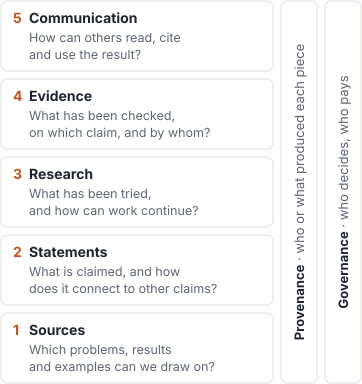

::: note
**Survey dated 21 October 2026.** Project descriptions and figures refer to that snapshot. See [sources and method](#sources) for its scope and limitations.
:::

Mathematical research leaves more than a proof. It starts from existing knowledge, gives precise form to a question, explores possible approaches, and produces an argument that others must check and understand. AI makes the organization of this work increasingly important: a result is useful only if someone can find it, assess what it establishes and build on it.

This page maps the tools that support those activities. For example, a problem registry helps identify a question, while a record of failed approaches helps the next investigation continue. A formal proof provides evidence of correctness, while an explanation helps a reader understand the result. These are connected needs, often served by different systems.

The five layers below group **functions**, not projects or levels of maturity. A project can serve several layers, and research moves back and forth between them. Provenance and governance apply throughout. Read the introductions and closing assessments for an overview; expand the inventories for more projects and technical detail.

{#fig-layers fig-alt="Five equally styled boxes, from bottom to top: Sources, Statements, Research, Evidence and Communication. Two vertical bars represent provenance and governance."}

## 1. Sources — Finding problems and existing knowledge {#sources-problems}

*What can an investigation start from?*

Problems, papers, examples and formal libraries provide different kinds of starting material. Finding them is a prerequisite for using them: a search that misses an existing result can spend its effort rediscovering it.

### Problems and conjectures

[Erdős Problems](https://www.erdosproblems.com/) illustrates an editorially maintained collection with stable problem numbers and discussion. [Formal Conjectures](https://github.com/google-deepmind/formal-conjectures) makes questions available as Lean statements. [Large Math Initiative](https://largemath.org/) explores extraction at a much larger scale, with academic ownership still unassigned for many entries in the survey. The differences concern both how questions enter a collection and who maintains their status.

Problem collections, benchmarks and bounds trackers

**Problem registries curated by people**

::: plain
- [Erdős Problems](https://www.erdosproblems.com/) (T. Bloom): 1,221 numbered problems with a forum. On 6 October 2026 it dropped open/solved statuses, froze proof claims, and asked for Lean proofs to be registered on Palomar.
- [teorth/erdosproblems](https://github.com/teorth/erdosproblems): the YAML database behind it. Key rule: a formal solution not yet "digested by a human reader" keeps its informal status, e.g. "open (Lean)".
- [Kourovka Notebook](https://arxiv.org/abs/1401.0300) (v49, 20 October 2026), [TOPP](https://topp.openproblem.net/), [AIM problem lists](https://aimath.org/problemlists/), [Ben Green's 100 open problems](https://people.maths.ox.ac.uk/greenbj/papers/open-problems.pdf), [MathOverflow `open-problems`](https://mathoverflow.net/questions/tagged/open-problems). Registries with named editors show recent activity; on [Open Problem Garden](https://www.openproblemgarden.org/), which names no editor, most recent activity on 21 October 2026 was spam.
:::

**Registries built for or by AI**

::: plain
- [Formal Conjectures](https://github.com/google-deepmind/formal-conjectures) (Google DeepMind): 4,137 Lean statements (1,514 open, 2,623 solved, 1,012 formally proved, per its docs); recommends linking research proofs to Palomar; uses AI provers to expose bad statements.
- [Large Math Initiative](https://largemath.org/): 114,879 open problems on its front page (125,434 under "Browse all"), mostly extracted automatically from papers, two AI judges per proposed solution, a named academic "owner" per problem (most still "Needs an owner"). The site names no operator.
- [We-Solve](https://we-solve.github.io/contribute/): archive of research problems with a strict disclosure rule (every human and model, with versions, settings and time budgets).
- [FrontierMath: Erdős](https://epoch.ai/latest/announcing-frontiermath-erdos) and [FrontierMath: Open Problems](https://epoch.ai/frontiermath/open-problems) (Epoch AI), [First Proof](https://1stproof.org/) (blind human refereeing, release of referee reports and system logs), [AlphaEvolve repository of problems](https://github.com/google-deepmind/alphaevolve_repository_of_problems).
:::

**Bounds and constants trackers**

::: plain
- [Optimization Constants in Mathematics](https://teorth.github.io/optimizationproblems/) (Davis, Ivanisvili, Tao): 117 constants; weakly verified bounds carry an asterisk. [Leaps in Bounds](https://leapsinbounds.org/), [ANTEDB](https://teorth.github.io/expdb/).
:::

### Literature and search

[zbMATH Open](https://api.zbmath.org) provides a maintained bibliography; [Semantic Scholar](https://www.semanticscholar.org) offers another route into the literature. [TheoremSearch](https://www.theoremsearch.com) searches at the level of mathematical statements. Retrieval helps locate relevant material; it does not itself establish that a claim is new or equivalent to another one.

Bibliographic resources and knowledge graphs

[zbMATH Open](https://api.zbmath.org) and its [knowledge graph](https://github.com/zbMATHOpen/zbmath-open-kg) (168M triples, CC BY-SA): an open, maintained bibliography layer already exists. [arXiv](https://arxiv.org), [MaRDI](https://portal.mardi4nfdi.de/wiki/Portal), [Semantic Scholar](https://www.semanticscholar.org).

For formal mathematics, the survey also records LeanSearch, Loogle and [LeanExplore](https://github.com/lean-explore/lean-explore) as search tools. Their role here is retrieval; interfaces used inside an agent workflow are described under [proofs and formalizations](#agent-tooling).

### Mathematical objects and examples

[LMFDB](https://www.lmfdb.org), [OEIS](https://oeis.org) and [π-Base](https://topology.pi-base.org) organize objects and examples rather than papers. They provide material for testing conjectures and finding counterexamples. Their curation policies also determine how results from an investigation can be contributed back.

Object databases and contribution policies

Object databases: [LMFDB](https://www.lmfdb.org) (with a read-only MCP server), [OEIS](https://oeis.org), [π-Base](https://topology.pi-base.org), [House of Graphs](https://houseofgraphs.org), [CatDat](https://catdat.app), [FindStat](https://www.findstat.org), indexed by [MathBases](https://mathbases.org). Sources of test cases and counterexamples. The OEIS policy (approved 29 August 2026) requires a responsible human author and forbids AI authorship, AI-written comments and bulk AI submissions.

### Formal libraries

[Mathlib](https://mathlib.org/) supplies definitions and theorems that a Lean development can reuse. [Isabelle AFP](https://isa-afp.org/) offers a refereed archive in a different proof assistant. [Tau Ceti](https://taucetiproject.org/) illustrates a different contribution model, with agents writing and reviewing against human-authored targets and rubrics.

Here the libraries are sources of reusable mathematics. Their checks belong to [Evidence](#formal-certification), and responsibility for their contributions belongs to [Governance](#governance).

Libraries, formalization collections and contribution models

The survey records several contribution models for AI-written formal code:

::: plain
- human review of every contribution, with mandatory AI disclosure: [Mathlib](https://mathlib.org/) (139,524 definitions and 291,055 theorems per its stats page), supported by the [Mathlib Initiative](https://mathlib-initiative.org/);
- humans write targets and review rubrics, agents write and review: [Tau Ceti](https://taucetiproject.org/) (17,621 reviewed PRs between 22 July and 21 October 2026, self-reported); [Formal Frontier](https://github.com/orgs/FormalFrontier/repositories) has agents write libraries from source texts, reviewed by AI according to the Xena post;
- reputation-gated auto-merge with no review: [merely-true](https://github.com/merely-true/merely-true). [Lean Pool](https://github.com/LeanPool/lean-pool) (316 projects, about 11.8M lines, self-reported) describes itself as sitting "between mathlib and merely-true".
:::

Outside libraries: [Anthropic's FLT formalization](https://github.com/anthropics/fermats-last-theorem) (about 13M lines in 11 days; "written to be checked rather than read"), [ATLAS](https://github.com/facebookresearch/atlas-lean) (Meta, 26 textbooks), [OddOrder](https://github.com/yawara/odd-order), [Hex](https://github.com/leanprover/hex), [Isabelle AFP](https://isa-afp.org/) (a refereed archive organized as a journal), [MathComp](https://math-comp.github.io/), [Metamath](https://us.metamath.org/) (five independent verifiers), and [HOL Light](https://github.com/jrh13/hol-light), which on 20 October 2026 added four autoformalizations produced by Claude. The formal side is not Lean-only.

::: finding
**Available:** substantial collections of problems, literature, examples and formal mathematics. **Still difficult:** searching across collections and reconciling their identifiers and statuses. Access for agents is also uneven: the surveyed LMFDB interface supports reading, while contributing corrections remains a separate workflow.
:::

## 2. Statements — Identifying claims and their connections {#statements-identity}

*What exactly is being claimed, and how does it relate to other claims?*

A paper may contain many statements; two papers may express the same theorem differently. This layer makes claims addressable, records their dependencies and connects informal statements to formal versions.

### Statements and definitions

[TheoremGraph](https://arxiv.org/abs/2606.25363) and [Matlas](https://matlas.ai) extract statements at scale. Extraction makes a large body of mathematics searchable, but a reader still needs to know which definitions and hypotheses apply, whether the statement is conjectural, and whether an apparent duplicate really has the same meaning.

Statement extraction: scale and limitations

**Extraction at scale.** [TheoremSearch](https://www.theoremsearch.com) (8.4M theorems indexed, REST and MCP), [TheoremGraph](https://arxiv.org/abs/2606.25363) (11.7M statements, 18.3M candidate edges, 47,952 arXiv↔︎Lean matches accepted by an LLM judge), [Matlas](https://matlas.ai) (8.07M statements from journals and textbooks). The survey did not identify comprehensive deduplication, status curation (proved / conjectural / refuted), or human checking of the extracted links in these systems.

### Dependencies and reductions

A **blueprint** is a plan of a formalization: statements and dependencies are linked to code, making completed and remaining work visible. [leanblueprint](https://github.com/PatrickMassot/leanblueprint) supports this approach. [IEANTN](https://github.com/teorth/IEANTN) instead audits a literature through conditional theorems and justifications, with verification receipts recorded separately from the claims.

Dependency graphs and blueprint tools

**Claim graphs.** [IEANTN](https://github.com/teorth/IEANTN) (Tao): nodes are conditional theorems; justification is metadata; receipts are written by the verifier, never the author; fingerprints make a change of meaning visible as a diff; tasks are claimed with a bot. It audits the dependencies of a literature rather than recording a search.

**[Blueprints](#glossary-blueprint).** [leanblueprint](https://github.com/PatrickMassot/leanblueprint) (de facto standard, no commits since December 2025), [Verso Blueprint](https://github.com/leanprover/verso-blueprint), [LeanArchitect](https://github.com/hanwenzhu/LeanArchitect) (machine-readable export), [Lean Atlas / Lean Compass](https://github.com/NyxFoundation/lean-atlas) (reduces the set of nodes a human must check for faithfulness by 27–99 %), [KnowTeX](https://arxiv.org/abs/2601.15294) (dependency graphs from LaTeX).

### Identifiers and correspondences

The [Stacks Project](https://stacks.math.columbia.edu) gives statements permanent tags. [Wikidata](https://www.wikidata.org) supplies shared identifiers, called QIDs, and Mathlib cross-references connect declarations to outside resources. These links are the beginnings of a **crosswalk**: a table of correspondences between identifiers in different systems.

Identity needs care. A fingerprint that survives renaming of a formal declaration does not, by itself, recognize every mathematically equivalent formulation.

Identifiers, cross-references and formal fingerprints

**Curated identity.** The [Stacks Project](https://stacks.math.columbia.edu) (permanent tags; since October 2026 it hosts comments signed by an AI agent working for a named person, reporting misstatements found while formalizing), [Kerodon](https://kerodon.net), [Wikidata](https://www.wikidata.org) (QIDs; new property P14534 "Mathlib Declaration ID", June 2026), Mathlib's [cross-reference attributes](https://github.com/leanprover-community/mathlib4/blob/master/Mathlib/Tactic/CrossRefAttribute.lean) (since May 2026: Stacks, Kerodon, Wikidata, LMFDB, π-Base, DLMF, OEIS), [1000+ theorems](https://1000-plus.github.io) (keyed by QID), [`semantic_hash`](https://github.com/mathlib-initiative/semantic_hash) (rename-invariant hashes of Lean constants).

::: finding
**Available:** large statement indexes, curated identifiers and explicit dependency graphs. **Still difficult:** maintaining the meaning, status and identity of a claim across systems. The survey found useful pairwise links, but no general crosswalk joining informal claims, formal declarations and registry entries.
:::

## 3. Research — Organizing work and preserving attempts {#research}

*How can an investigation be continued by someone who did not take part in it?*

Research produces intermediate claims, examples, failed approaches and unresolved obstacles. Tools in this layer help conduct that work and preserve enough of it for others to continue.

### Explore possible approaches

[AlphaEvolve](https://github.com/google-deepmind/alphaevolve_results) explores candidates through evolutionary search. Other systems use agents to propose arguments, test hypotheses and criticize partial solutions. The distinction that matters for a continuing investigation is what survives: a final candidate, a selection of attempts, or a record of why routes were abandoned.

Published exploration traces and their limits

**Records from human-led collaborations.** Tao's [tenth-discriminant challenge](https://terrytao.wordpress.com/2026/10/20/an-experimental-ai-math-challenge-using-tenth-discriminant-bounds-to-explore-arguments-ruling-out-siegel-zeroes/) (20 October 2026) welcomes negative results and asks that AI output be checked by an independent tool, but its record is the comment thread. The [Kalai–Hajaj–Kaminer "Polymath plus AI"](https://gilkalai.wordpress.com/2026/04/03/polymath-plus-ai/) projects collect human and AI suggestions as blog comments, with no record of which were tested or rejected. The [Equational Theories Project](https://teorth.github.io/equational_theories/) paper calls its blueprint "the only comprehensive record" of the techniques used.

**Labs publish process selectively.** Anthropic's [zeta result](https://www.anthropic.com/research/riemann-zeta) reports about 650 ideas tried in a first attempt, "none of which worked", and publishes transcripts. OpenAI's [openai/math](https://github.com/openai/math) gives abridged reasoning summaries for 10 of 372 families and a withdrawal history, but nothing on the failed problems among about 4,000 posed. The [AlphaEvolve problem repository](https://github.com/google-deepmind/alphaevolve_repository_of_problems) has a "worse than literature bound" status, the only negative category we found on the lab side. The community wiki on AI contributions to Erdős problems states that negative results are under-reported.

**Preservation is a concern.** At the survey date, the Polymath wiki returned 404 and Woeginger's list of claimed P-vs-NP proofs returned 503; those responses alone do not establish whether their contents have been permanently lost.

### Develop proofs and formalizations {#agent-tooling}

[Prove2Me](https://prove2.me/) coordinates formalization work through missions and server-side checks. [LeanFlow](https://github.com/epfl-lara/LeanFlow) combines proof work with failed-attempt memory and run evidence. The broader pattern is to divide a development into statements, assign work, and check contributions before incorporating them.

A **harness** is the software that controls an agent's tools, context and stopping conditions. Interfaces such as MCP let the agent call a proof assistant or database; hosted environments supply the surrounding computation. These mechanisms support the research workflow, but do not replace its mathematical checks.

Proof services, coordination tools and computing environments

::: plain
- **Formal coordination platforms** in the survey share a recurring design: a graph of Lean statements as the system of record, contract-scoped worker and reviewer agents, [CI](#glossary-ci) gating, faithfulness checked before proving. [Prove2Me](https://prove2.me/) (missions, server-side checking, `SKETCH_ACCEPTED` for reductions to open children, blind "read-backs" of statements by fresh-context agents; the coordination layer of Anthropic's FLT formalization), [Archon / Archon Horizon](https://github.com/frenzymath/Archon-Horizon), [LeanMarathon](https://github.com/YuanheZ/LeanMarathon), [LeanFlow](https://github.com/epfl-lara/LeanFlow) (failed-attempt memory, per-project run evidence), [`tend` and `pod`](https://github.com/mathlib-initiative/tend) (Mathlib Initiative), [Tau Ceti](https://taucetiproject.org/) workers, [OpenGauss](https://github.com/math-inc/OpenGauss).
- **Provers and services**: [Aristotle](https://aristotle.harmonic.fun/) (Harmonic), [Gauss](https://www.math.inc/gauss) (Math Inc.), [AXLE](https://axle.axiommath.ai/) (Axiom), [AlphaProof Nexus results](https://github.com/google-deepmind/alphaproof-nexus-results), [Aletheia](https://github.com/google-deepmind/superhuman) (raw prompts and responses published), open provers (DeepSeek-Prover, Goedel-Prover, Kimina, Seed-Prover), evolutionary search ([AlphaEvolve](https://github.com/google-deepmind/alphaevolve_results), [OpenEvolve](https://github.com/algorithmicsuperintelligence/openevolve), [ShinkaEvolve](https://github.com/SakanaAI/ShinkaEvolve)).
- **Interfaces**: [lean-lsp-mcp](https://github.com/oOo0oOo/lean-lsp-mcp), [lean-beam](https://github.com/leanprover/lean-beam) (Lean FRO), [LeanExplore](https://github.com/lean-explore/lean-explore), TheoremSearch MCP, [MathModDB MCP](https://github.com/MaRDI4NFDI/MathModDB-MCP), [Wolfram MCP](https://www.wolfram.com/artificial-intelligence/mcp/), SageMath MCP servers; skill packs such as [lean4-skills](https://github.com/cameronfreer/lean4-skills) and [LeanAutoformalizationSkills](https://github.com/scottnarmstrong/LeanAutoformalizationSkills).
- **Hosted environments**: [SAIR Open Math OS](https://www.openmathmodel.org/) (open-weight models, a 24/7 machine per project with Lean, Mathlib, SageMath and PARI/GP, team accounts in which members see each other's prompts; soft launch 16 October 2026).
- **Harness optimization**: [Harness²](https://github.com/google-research/harness2) (Google Research) tunes an agent's [harness](#glossary-harness) against recorded runs. Not specific to mathematics.
:::

### Coordinate work and retain its history {#process-records}

[Euler](https://github.com/canghaimeng/Euler) maintains goals, routes and blockers, passing prior failures to later tasks. [Math Lab](https://github.com/Joe975/math-lab) records failed attempts and compares agents that have or have not seen them. [labyrinth-exploration](https://github.com/nasqret/labyrinth-exploration) organizes work as proved paths, refutations and open directions.

These systems illustrate a **process record**: a structured account of what was tried and why it succeeded, failed or remains unresolved. The useful unit is an approach with its reasons, not just an unfiltered conversation log.

Comparison of research-memory systems and repository templates

::: table-wrap
| project | research memory | distinctive feature |
| ---- | ---- | ---- |
| [Euler](https://github.com/canghaimeng/Euler) ([paper](https://arxiv.org/abs/2610.19864), 14 Oct 2026) | frontier of goals, live routes, blockers; each task receives its "prior failures"; a step closes only when evidence of the contracted level is registered | interactive dashboard, non-commercial licence |
| [math-god](https://github.com/managed-kortix/math-god-adfd91b6-ff4b-48dd-aca6-d0bdeb719003) | per problem `prompt.md`, `plan.md`, `notebook.md`, `attempts/` (one file per approach, "why it lived or died"); its Millennium-Prize programme adds `routes.md` and `audit.md`, one main line of attack and bounded scouts | aims at many problems |
| [Math Lab](https://github.com/Joe975/math-lab) | attempts "including, especially, the failed ones", dead ends, `refuted_by`, gaps | **blind versus informed agents**, enforced in CI, to test whether prior failures help or anchor |
| [Plectis](https://github.com/wcook04/plectis-erdos) | argument frontier, claims, ledger corrections, statement migrations, failed approaches | many JSON indices and ledgers |
| [open-problems](https://github.com/dpreil-ydlp/open-problems) | negative results kept; candidates and why they were or were not attempted | per-role AI attribution |
| [structured-math-research](https://github.com/Caie777/structured-math-research) | claims, proofs, gaps, failed attempts | prototype |
| [labyrinth-exploration](https://github.com/nasqret/labyrinth-exploration) (B. Naskręcki) | a map: proved corridors, refuted walls, open doors; claims tiered T1–T6; "a refutation counts as progress" | a skill, not a repository contract |
| [OpenTheory](https://github.com/kaminocorp/opentheory) | append-only ledger, "dead ends are recorded, not deleted", actor recorded per contribution | hosted app |
| [AI co-mathematician](https://arxiv.org/abs/2605.06651) (Google DeepMind) | "tracks failed hypotheses", version history of claims | closed |
:::

Also relevant: [QED](https://github.com/proofQED/QED) (per-round records of proof attempts), [math-research-harness](https://github.com/haruhisa-enomoto/math-research-harness) (a repository template: files in git, an agent contract, per-thread ledgers), [conjecture-prover](https://github.com/RealInsistWu/conjecture-prover) (a Codex skill with a proof contract, a route registry and a dependency graph; nothing persists across sessions), [claude-math-research-skill](https://github.com/OctopusTide/claude-math-research-skill) (checks a known-obstacle list *before* launching an attempt).

::: finding
**Available:** several systems explicitly preserve attempts, obstacles and refutations. **Still difficult:** transferring that memory between projects and keeping it available over time. The survey found no shared exchange format among these systems; the [Portolan Negative-Results Record](https://github.com/portolansoft/nrr), outside mathematics, offers a related schema to examine.
:::

## 4. Evidence — Assessing what a result establishes {#formal-certification}

*What has been checked, on which statement, and by whom?*

“Verified” is too compressed to answer this question. Formal correctness, fidelity to the intended statement, review of an argument and novelty concern different things. Human and automated reviewers can contribute to several of these checks; their identity, scope and independence should be recorded separately.

### Formal correctness

A proof assistant's **kernel** checks a proof against a formal statement. That is a precise guarantee, relative to the definitions and assumptions used. [Comparator](https://github.com/leanprover/comparator) checks that a submitted proof targets the trusted statement. [Palomar](https://palomar-registry.org/) registers versioned formal results, making it possible to refer to the checked artifact.

Formal certificates and their components

**A certificate stack** emerged within six months: `Challenge.lean` (trusted statement) + `Solution.lean` + `comparator.json` + `formalization.yaml` + `lake check` and [nanoda](https://github.com/ammkrn/nanoda_lib), registered as a versioned [Palomar](https://palomar-registry.org/) ID. It is used by Anthropic's [formal-math](https://github.com/anthropics/formal-math), openai/math, Formal Frontier, [LeanEval](https://lean-lang.org/eval/) and Palomar itself (690 results across 557 projects on 21 October 2026). [Comparator](https://github.com/leanprover/comparator) is now part of Lean core.

### Statement faithfulness

Suppose someone wants to prove Goldbach's conjecture, but accidentally formalizes only the assertion for even numbers from 4 to 1,000. Lean can accept a correct proof of that bounded assertion. The kernel check passes; the intended conjecture has not been proved. This is an illustration, not a reported case.

**Faithfulness** asks whether the formal statement expresses the intended mathematics. The [Annals Challenge](https://github.com/ImperialCollegeLondon/AnnalsChallenge) provides a concrete warning: the survey reports formalization mistakes found by AI audits in 11 of 50 expert-written and reviewed statements. Human review and automated read-backs can both address this question; proving the supplied target does not settle it.

Faithfulness audits and screening tools

[Annals Challenge](https://github.com/ImperialCollegeLondon/AnnalsChallenge) (50 hand-written statements of Annals results; 11 with formalization mistakes found by AI audits after expert review), ["Faults in Our Formal Benchmarking"](https://arxiv.org/abs/2606.29493) (398 mechanically certified defects in five benchmarks), [definition grounding](https://arxiv.org/abs/2610.19223) (25–50 % of agent-formalized definition sets compatible with later statements), [leanscreen](https://github.com/ibrahimmian36/leanscreen) ("may only reject"), [FLMF](https://arxiv.org/abs/2610.20573).

### Review of mathematical arguments

[ProofForum](https://www.proofforum.org/) attaches reviews to a theorem and an exact version, distinguishing AI, community and certified-referee signals. [First Proof](https://1stproof.org/) uses blind human refereeing. [Pith](https://pith.science) offers automated public reviews of preprints, explicitly described as no substitute for expert scrutiny.

A review should say what was read, which issues were examined, and what the reviewer had already seen. Agreement between agents that share the same earlier critique does not provide the same evidence as independent examination. A named human review and an automated review should remain distinguishable, even when they address the same question.

Review protocols and evidence labels

[ProofForum](https://www.proofforum.org/): per-theorem review of an exact version, with four separate signals (AI check, community checks, a five-referee institutional consensus, a signed verdict by a certified referee). [First Proof](https://1stproof.org/): blind refereeing on a four-level scale (flawless / minor / major / reject, per its second-batch page). [Pith](https://pith.science): automated public reviews of about 398,000 preprints, "no substitute for expert scrutiny".

Existing labels use different vocabularies: VibeMathed's levels, `formalization.yaml` review status, ProofForum's signals, Hexagon's labels and the [ACL survey's evidence ladder](https://aclanthology.org/2026.bigpicture-main.2). Comparing them requires retaining the scope of the check and the kind of reviewer, rather than treating every label as one rung on a common scale.

### Novelty and prior work {#novelty}

A correct result can already be known. Palomar explicitly does not judge novelty; a formal certificate therefore cannot stand in for a literature assessment. The [aimath index](https://aimath.robertj1.com/) includes a claim audit, while Large Math Initiative records literature status. These are useful entry-level signals; the survey did not identify a shared novelty-certification process.

Prior-art fields and literature checks

Examples recorded by the survey: the categories of the community wiki on AI contributions to Erdős problems (AI standalone / alongside literature / building on literature / with humans), Large Math Initiative's "literature status", the [aimath index](https://aimath.robertj1.com/)'s "claim audit", Anthropic's report that subagents checked 54 arXiv papers, [Cited by AGI](https://citedbyagi.com/) (which ranks the human authors cited by the OpenAI manuscripts).

::: finding
**Available:** formal checking and several forms of human and automated review. **Still difficult:** making the scope of each check explicit and comparable. The survey found no shared structured record for faithfulness reviews or reviewer independence; novelty assessment remains separate from proof checking.
:::

## 5. Communication — Making mathematics readable and reusable {#venues}

*How does a result become something another mathematician can read, cite and use?*

A checked artifact, an understandable explanation and a citable deposit serve different purposes. This layer concerns how mathematics reaches its readers, including the editorial work that selects and presents it.

### Explanation and synthesis

[The Bourgain Project](https://bourgain-pedia.com/) develops digestions of difficult papers. [Mathematical Discourse](https://www.mathematicaldiscourse.org/) reviews video exposition. [oai-math-revised](https://github.com/mathcommunity/oai-math-revised) improves the exposition of released AI mathematics. Each makes understanding a task in its own right.

Exposition projects and editorial expectations

**Exposition.** [The Bourgain Project](https://bourgain-pedia.com/) (a bibliography of 523 papers, 18 digestions so far; "If a step in Bourgain's paper could not be verified, the digestion should say so plainly"; AI use must be disclosed), [Mathematical Discourse](https://www.mathematicaldiscourse.org/) (a video [overlay journal](#glossary-overlay) that reviews exposition, not correctness), [Paper of the Future Prize](https://amathr.org/prizes/paper-of-the-future-prize/), [oai-math-revised](https://github.com/mathcommunity/oai-math-revised) (a community overlay improving the OpenAI write-ups), Tao's digestion posts.

### Deposit and citation

[arXiv](https://arxiv.org) provides a familiar place to deposit manuscripts. [Hexagon](https://hexagonmath.org/) separates deposit from peer review and asks for labels concerning text origin and human understanding. A deposit makes work accessible and citable; readers still need to inspect the evidence attached to it.

Depositories, labels and submission policies

**Deposit.** [arXiv](https://info.arxiv.org/help/moderation/index.html) requires disclosure of significant AI use and, from 1 October 2026, limits each submitter to two new submissions per month. [Hexagon](https://hexagonmath.org/) (open since 28 September 2026; no peer review; two mandatory labels, text origin and **human understanding**; REST API and MCP endpoint). [Annals of Formalized Mathematics](https://afm.episciences.org/).

### Publication and editorial selection

[Annals of Formalized Mathematics](https://afm.episciences.org/) and the refereed [Isabelle AFP](https://isa-afp.org/) illustrate publication organized around formal mathematics. A venue's review policy determines which submissions it can assess and endorse; the underlying kinds of evidence are described in [Evidence](#formal-certification).

Capacity is part of this landscape. The survey records journal submission pauses and proposals for new venues, alongside efforts to make exposition and human understanding visible.

Journal initiatives and review capacity

**Journals.** A planned journal requiring Lean-verified proofs (Guo et al., [Tao's blog, 17 October](https://terrytao.wordpress.com/2026/10/17/starting-a-new-journal/)); it has not said how it will check statements. Six probability and statistics journals [paused submissions](https://www.edpsciences.org/en/news-highlights/3058-esaim-probability-and-statistics-takes-action-to-address-increasing-manuscript-submissions) from 19 October to 8 November 2026, citing AI-driven volume.

::: finding
**Available:** distinct venues for deposit, review and exposition. **Still difficult:** connecting those services and accommodating research that has not produced a finished theorem. The survey did not identify a dedicated venue for reviewed, citable route reports or obstacle notes.
:::

## Across the layers: provenance and governance {#across-layers}

### Attribution and traceability {#provenance}

*Who or what produced each contribution, and how?*

[`formalization.yaml`](https://github.com/mathlib-initiative/formalization.yaml) records sources, automation, models and review metadata for formalizations. Hexagon's labels and the [LMS AI Declaration](https://www.lms.ac.uk/publications/policies/AI) address disclosure in publication. These practices make the contribution of humans and models more visible, but the survey found that attribution is usually attached to a project or paper rather than each claim.

Provenance formats, disclosure policies and adoption

The survey records several approaches to disclosure:

::: plain
- [`formalization.yaml`](https://github.com/mathlib-initiative/formalization.yaml) v0.4 (Mathlib Initiative): sources with author endorsement, automation method (manual / copilot / agent / autonomous), models, cost, review status, alignment of statements. Required by Palomar, used by openai/math, recommended by AGMAI. Unknown keys are tolerated. **It has no fields for routes, obstacles or negative results.**
- Hexagon's two labels; ProofForum's "uploaded by" versus "generated by"; the [LMS AI Declaration](https://www.lms.ac.uk/publications/policies/AI) (mandatory, covers "constructing or verifying proofs"; bans AI in refereeing); Elsevier's declaration; the proposed [AIL2026](https://zenodo.org/records/23424830) labels (`AI-3: Proof3 Text1`); the taxonomy of the community wiki on AI contributions to Erdős problems; per-role attribution in open-problems ("proofs by X, reviews by Y").
- H. De Bie's [survey](https://proofsandprompts.com/2026/10/16/on-ai-statements-in-mathematics-papers/) of 152 arXiv papers (math.CA and math.RT, September 2026): 34.9 % used AI for the mathematics, 55.9 % had no AI statement.
:::

### Maintenance, funding, access and responsibility {#governance}

*Who maintains the infrastructure and is accountable for it?*

[AGMAI's guidelines](https://agmai.org/general-sep29/) call for independent deposits, disclosure of prompts and compute, and reporting of unsuccessful attempts. [Lean FRO](https://lean-lang.org/fro/about/) supports the formal tooling on which many projects depend. Funding programmes shape which parts of the infrastructure receive sustained attention.

Responsibility also appears in everyday contribution rules: who may change a curated database, who reviews additions to a library, and who retains the logs of a hosted investigation. A usable system needs maintainers and a durable home for its records as well as a technical interface.

Declarations, institutions and funding

::: plain
- **Advice and declarations.** [AGMAI](https://agmai.org/) (Advisory Group on Mathematics and AI: Charles, De Lellis, Gowers, Hairer, Srivastava, Tillmann, Vakil, Witten, Wood). Its [guidelines of 29 September 2026](https://agmai.org/general-sep29/) ask labs to deposit in repositories they do not control, to disclose prompts and compute, and to publish "unsolved attempts of comparable difficulty" with the selection procedure. The [Leiden Declaration](https://leidendeclaration.ai/) (endorsed by the IMU, ICARM and the Mathlib Initiative; not by the EMS). The Fields medallists' ["A Severe Misalignment of AI in Mathematics"](https://mathandai.org/). The [Association for Human Mathematics](https://www.ahmath.org/). Position papers: [How to Formalize All of Mathematics](https://xenaproject.wordpress.com/2026/10/16/how-to-formalize-all-of-mathematics/) (ten principles), [Maggi](https://terrytao.wordpress.com/2026/10/18/will-it-be-a-golden-age-or-a-dark-age-for-mathematics-and-science/), Tao's [views on AI](https://teorth.github.io/tao-web/ai-views.html) ("disclose the actual chat logs and traces", "admitting the failed attempts along the way"; a mechanism to put unfinished proofs "up for adoption").
- **Institutions.** [Lean FRO](https://lean-lang.org/fro/about/), [ICARM](https://icarm.io/), [Isaac Newton Institute](https://www.newton.ac.uk/news/ini-news/ini-awarded-funding-to-host-ai-for-maths-programme/) (a 2027 programme on standards for evaluating AI-assisted work), Fields, ICERM, SLMath, ICMS.
- **Funding.** [Simons Foundation \$15M](https://www.simonsfoundation.org/news/simons-foundation-launches-15m-effort-to-help-mathematicians-navigate-ai-era/) (with Anthropic and OpenAI; call for Math+AI institutes due 1 December 2026), [AI for Math Fund](https://www.renaissancephilanthropy.org/ai-for-math-fund) (22 awards in 2026; none on process records), [DARPA expMath](https://www.darpa.mil/research/programs/expmath-exponential-mathematics).
- **Running commentary.** [Proofs and Prompts](https://proofsandprompts.com/) keeps a running newsfeed of statements, policies and venues.
:::

::: finding
**Across all five layers:** attribution should remain attached to the work as it moves between systems, and maintenance arrangements should make clear who can correct or preserve it. The surveyed policies provide starting points, but their formats and responsibilities do not yet line up consistently.
:::

## What would connect these layers? {#connections}

Consider a possible path: a question is listed in a registry, explored in a research workspace, formalized and registered, then explained in a deposited manuscript. Each system holds something useful. The connecting records determine whether a reader can follow the whole path.

.](../figures/flow.svg){#fig-flow fig-alt="Four boxes from top to bottom: problem registry, process record, formal proof, deposit and review, joined by dashed arrows. A solid arrow labelled Palomar IDs goes from the problem registry straight to the formal proof."}

Three connections deserve particular attention:

- **Link statements across systems.** Preserve the intended claim, its versions and the correspondences between registry entries, manuscripts and formal declarations.
- **Retain attempts with their reasons.** Make routes, obstacles and refutations portable enough for another investigation to continue, and durable enough to survive a change of host.
- **Make checks interpretable.** Attach the scope, version, reviewer and independence of each check to the claim it concerns. Keep provenance with those records.

There are useful foundations already: formalization metadata, trusted target statements, versioned result IDs and curated cross-references. The missing connections identified here are an assessment of the surveyed systems, rather than a claim that every component must be rebuilt.

Existing identifiers, metadata and exchange conventions

::: table-wrap
| convention | what it carries | used by |
|----|----|----|
| `formalization.yaml` v0.4 | provenance, automation, review status, alignment of statements | Palomar (required), openai/math, Anthropic, Formal Frontier |
| `Challenge.lean` + Comparator / `lake check` | the trusted formal statement, and the check that a proof proves exactly it | IEANTN, LeanEval, Palomar, Anthropic, openai/math |
| Palomar IDs (`PALOMAR-YYYY-MM-DD-NNNNNN-vN`) | a versioned, pinned formal result | erdosproblems.com, Formal Conjectures, PFR |
| Hexagon IDs (`hexagon:YYMM.NNNNNvN`), ProofForum IDs (`PF:YYYY.NNNNNN/vN/THM-x`) | a versioned deposit; a statement inside it | Hexagon, ProofForum |
| Stacks tags, Wikidata QIDs, Mathlib cross-references, P14534 | identity of concepts and theorems across resources | Mathlib, 1000+ theorems, Mathswitch |
| Erdős numbers, OEIS A-numbers, arXiv IDs, MathOverflow IDs | identity of problems and sources | most registries and trackers |
| `semantic_hash` | identity of a Lean statement under renaming | Mathlib Initiative |
| MCP servers, `SKILL.md`, `llms.txt` | agent access to tools, platforms and venues | Prove2Me, Hexagon, ProofForum, Palomar, LeanExplore, LMFDB |
| `CITATION.cff` | how to cite a repository | many repositories |
:::

A separate [comparison of infrastructure architectures](architectures.qmd) considers one platform, a federation and a new registry. It develops our proposal to start with shared records; the present page supplies the landscape behind that proposal.

## Glossary {#glossary}

::: glossary

[kernel]{#glossary-kernel}
: The small core of a proof assistant (Lean, Isabelle, Coq…) that checks every step of a formal proof. It checks the proof against the formal statement, not against what the author meant.

[statement faithfulness]{#glossary-faithfulness}
: Whether a formal statement says what the informal one says. A proof of an unfaithful statement proves a different theorem.

[Comparator]{#glossary-comparator}
: A Lean tool, now part of Lean core, that checks that a proof proves exactly the trusted statement written in a `Challenge.lean` file.

[blueprint]{#glossary-blueprint}
: A human-readable plan of a formalization: the statements and their dependencies, linked to the Lean code, showing what is done and what is left.

[crosswalk]{#glossary-crosswalk}
: A table of correspondences saying that identifiers in different registries name the same problem or statement.

[QID]{#glossary-qid}
: The identifier of an item in Wikidata (Q followed by digits), used by Mathlib and 1000+ theorems to name concepts and theorems.

[`semantic_hash`]{#glossary-semantic-hash}
: A fingerprint of a Lean statement that does not change when declarations are renamed.

[`formalization.yaml`]{#glossary-formalization-yaml}
: A metadata file describing a formalization: sources, how much was automated, which models were used, review status, alignment of statements. YAML is a plain-text format for structured data.

[process record]{#glossary-process-record}
: A structured record of a search rather than of its result: routes tried, obstacles, refutations, abandoned approaches, with the reasons.

[MCP]{#glossary-mcp}
: Model Context Protocol: a standard way for an AI agent to call an external tool or service, such as a proof assistant, a database or a search engine.

[`SKILL.md`]{#glossary-skill}
: A file of instructions that packages a task for an AI agent, such as formalizing a statement or refereeing a proof.

[harness]{#glossary-harness}
: The program around a model that runs it as an agent: which tools it can call, what it sees, when it stops, how its output is checked.

[CI]{#glossary-ci}
: Continuous integration: checks that run automatically on every change to a repository, for example rebuilding a Lean project.

[overlay journal]{#glossary-overlay}
: A journal that reviews and endorses work deposited elsewhere (arXiv, a repository) instead of publishing it itself.
:::
## Sources and method {#sources}

This page reorganizes a survey dated **21 October 2026**, covering about 330 entries across formal tools, knowledge resources, problem collections, collaborative research, venues and institutions. Projects were selected for serving a function in this landscape and being public, active or historically important; popularity was not a selection criterion.

The original survey checked primary pages, repositories and APIs, with separate passes over factual claims and links. This editorial revision retains that snapshot; it does not update project statuses. Figures marked “self-reported” are from the projects themselves. Closing assessments describe what the survey found, and should not be read as exhaustive claims about all mathematics infrastructure.

Survey checks, unavailable sources and limitations

**Method.** Six surveys (formal side; informal knowledge infrastructure; problems and results trackers; collaborative research and process records; venues, norms and institutions; agent tooling) opened each project's primary page on 21 October 2026, or used its API or repository when the site blocks automated clients, and recorded about 330 entries. GitHub dates come from the GitHub API. A separate pass checked the figures, dates and quotations on this page against those pages, and a final pass checked every cited link with an HTTP request: of the 479 distinct links the surveys collected, 451 answered HTTP 200 that day. Figures marked "self-reported" come from the project's own page and were not checked independently.

**Links in the survey notes that did not answer 200 on 21 October 2026** (28 of 479; all links cited on this page answered, except three rate-limited ones read through another client):

::: plain
- blocked automated clients (403) or rate limits (429): zbMATH Open web pages, swMATH, the AMS AI policy, groupprops, OpenAI's Navier–Stokes page, the Journal of Trial and Error, Proofs and Prompts, Large Math Initiative;
- dead or unreachable: Polymath wiki (404), Woeginger's P-vs-NP page (503), Moogle (404), MathGloss site (404), Encyclopedia of Mathematics (502), GAP website, KnotInfo's old domain, LemmaLab repository (404), Lean FRO Workbench (no public page);
- endpoints that expect a protocol or reject a plain request: TheoremSearch API (405), LMFDB MCP (406), Meta's AutoformBot publication page (400);
- truncated URLs in the notes, not dead pages: a FormaliaXiv path, a blog post on Comparator challenges, an NSF solicitation.
:::

**Secondary only (not confirmed on a primary page):** arXiv's "one strike" rule; Meta's "Muse Spark" papers; the *Science* publication of AlphaProof Nexus; product details of DeepMind's AI co-mathematician; the Jacobian conjecture counterexample attributed to Claude; the Yau Laboratory Alliance; the AMS AI policy and white paper; Tau Ceti's total line count; Prove2Me's total lines of Lean.

**Disagreement between surveys.** The problems survey found no project recording routes and obstacles for sustained search on one problem; the collaborative-research survey, which searched for exactly that, found about eight. The research-memory inventory incorporates those targeted findings ([research records](#process-records)).

